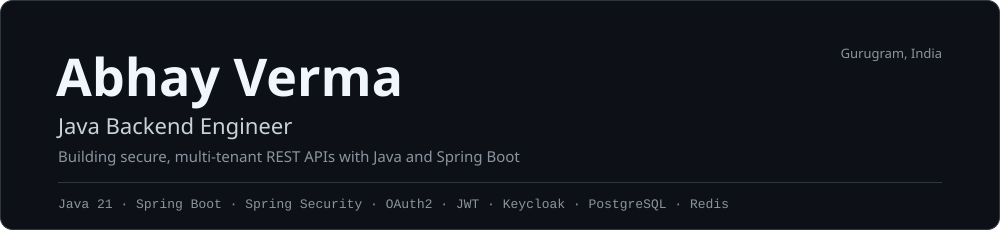
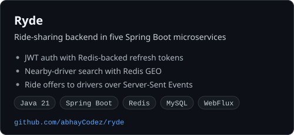
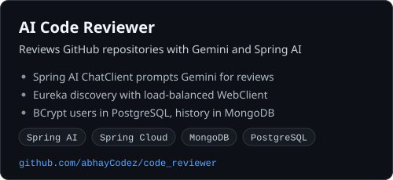

## About

I'm a backend engineer at **DGLiger Consulting**, working on the notification and template services of a multi-tenant platform in Java 21 and Spring Boot.

My focus is API security and data isolation:

- Securing endpoints with Keycloak-issued JWTs, the OAuth2 client-credentials flow and role-based permissions
- Keeping each tenant's data separate with PostgreSQL row-level security
- Carrying correlation-ID, actor and tenant headers through every request for tracing and audit trails

Outside work, I build multi-service systems to go deeper into service-to-service communication, token lifecycles and geospatial search. I also practise data structures and algorithms on LeetCode.

## Tech stack

| Area | Technologies |
|:--|:--|
| **Languages and frameworks** |        |
| **Security** |      |
| **Data** |      |
| **Tools and testing** |      |

## Featured projects

## Experience

| Role | Company | Period |
|:--|:--|:--|
| **Associate Software Engineer** | DGLiger Consulting, Gurugram | Sep 2026 – present |
| **Backend Developer Trainee** | PrepCode, Lucknow | 2025 |

## Education

**Bachelor of Computer Applications**, Ambalika Institute of Management and Technology, 2023 – 2026
