<div align="center">



**Building secure, traceable backend systems with Java and Spring.**

</div>


- 🏢 **Associate Software Engineer at DGLiger Consulting**, Gurugram. I build the notification and template services of **Startup India – BHASKAR** (DPIIT, Government of India) with Java 21 and Spring Boot.
- 🔐 **API security and data isolation** is my strongest area: Keycloak-issued JWTs, the OAuth2 client-credentials flow, role-based permissions, and multi-tenant isolation with PostgreSQL row-level security.
- 🧭 **Traceable by design:** correlation-ID, actor and tenant headers travel with every request, for tracing and audit trails.
- 🛠️ **Off duty**, I build multi-service systems: a ride-sharing backend and an LLM-powered code reviewer.
- 🧠 **Training:** data structures and algorithms on LeetCode.

```java
@Suit(mark = "JAVA-21", status = Status.ONLINE)
public class AbhayVerma implements BackendEngineer {

    private final String   role    = "Associate Software Engineer @ DGLiger Consulting";
    private final String   mission = "Startup India – BHASKAR: notification and template services";
    private final String[] armor   = {"Spring Security", "OAuth2", "JWT", "Keycloak", "RBAC"};
    private final String[] core    = {"Java 21", "Spring Boot", "Spring Data JPA", "PostgreSQL", "Redis"};
    private final String   focus   = "Secure, traceable, multi-tenant APIs";

    @Override
    public String motto() {
        return "Suit up. Ship secure APIs.";
    }
}
```


| Module | Gear |
|:--|:--|
| **Core systems** |       |
| **Armor** |      |
| **Power cells** |      |
| **Comms and AI** |     |
| **Workshop** |      |


<p align="center">
  <a href="https://github.com/abhayCodez/ryde"></a>
  <a href="https://github.com/abhayCodez/code_reviewer"></a>
</p>


| | Role | Where | When |
|:-:|---|---|---|
| 🟥 | **Associate Software Engineer** | DGLiger Consulting · Gurugram | Sep 2026 – present |
| 🟨 | **Backend Developer Trainee** | PrepCode · Lucknow | 2025 |
| 🎓 | **Bachelor of Computer Applications** | Ambalika Institute of Management and Technology | 2023 – 2026 |


<p align="center">
  <a href="https://www.linkedin.com/in/abhaycodez"></a>
  <a href="https://leetcode.com/u/abhayCodez"></a>
  <a href="https://github.com/abhayCodez?tab=repositories"></a>
</p>


